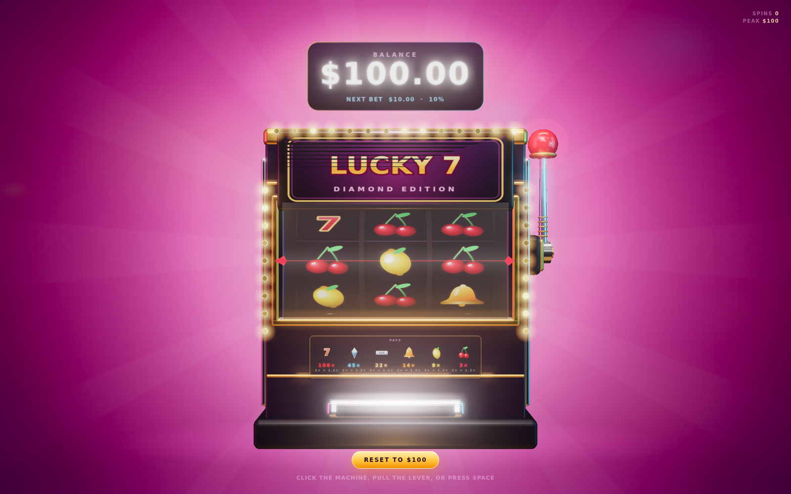
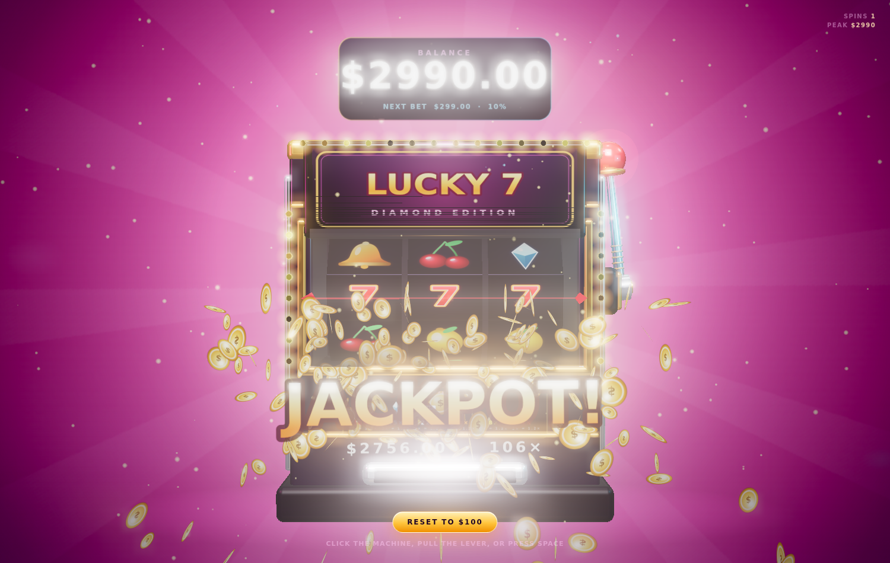
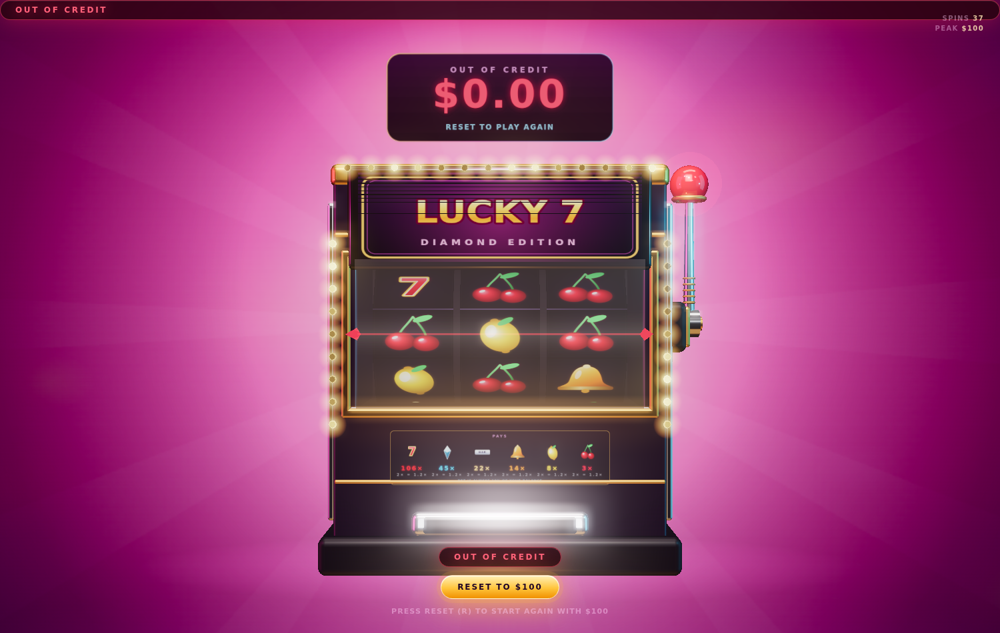

# Singularity

A three.js slot machine as a Mac wallpaper. Cause why not.



A graphite monolith with one big glass window, floating in front of a lensed
black hole. It tilts with your cursor, pays out in drifts of stardust, and
remembers your balance between reloads. You start with 100 stardust and every
pull automatically bets 10% of it — there is nothing to configure.

The design brief was "minimalist object, not a casino": the cabinet is
monochrome blue-black, the only saturation is one cold accent, and the wins are
celebrated with light rather than colour. Space is deliberately recessive — the
black hole sits behind and to the left of the machine, acting as a halo around
the silhouette instead of competing with it, and its rim is what makes the
brushed metal read as metal.

## Run it

**Live:** https://lajoonpark.github.io/Gamble/ (deployed from `dev` —
see [Deploying](#deploying) for the one-time Pages setting)

```sh
npm start            # http://127.0.0.1:5173
```

Click the machine, grab the lever, or press `Space` to spin.

| Key | Action |
| --- | --- |
| `Space` / `Enter` / click | Pull the lever |
| `R` | Reset to 100 stardust |
| `H` | Hide the HUD (wallpaper mode) |

`?seed=123` makes the spins deterministic; `?autoplay=1` spins forever.

## The game

- Bet is always 10% of the current balance, deducted on pull, paid back on stop.
- Three of a kind pays a symbol multiple (asteroid 3× … singularity 106×). Any
  pair pays 1.2×.
- Symbols are read by silhouette, so they stay legible in monochrome, and rarity
  reads as brightness: dim slate for the common rock, ice-white for the jackpot.
  The top prize is a black hole, which eats everything — including your balance.
- Measured over all 1728 reel combinations: **96.47% RTP, 52.1% hit rate**.
  Sessions trend down — the median balance falls to ~6 over a few hundred spins
  — but roughly one run in a hundred peaks above 1,000.
- Two premium symbols on the first two reels make the third reel crawl and
  brighten (anticipation), because near-misses are most of the fun.
- Balance, spin count and peak persist in `localStorage`. `Reset` starts a clean run.
- Leave it alone for ~14 seconds and it spins itself, with no effect on your money.
  The first mouse move takes control back immediately.

|  |  |
| --- | --- |
| Triple singularity | Out of stardust |

## Resting

A wallpaper that renders all day is a battery problem, so the render loop parks
itself when it is not being looked at:

- **Hidden** — the page is not visible (another Space, another tab). Detected via
  `visibilitychange`.
- **Covered** — a window is over the machine. A web page cannot read other
  applications' window rects, so this is approximated: if the pointer is outside
  this window and there has been no input for 45 s, the machine is treated as
  covered. On a real wallpaper host this should be replaced with the host's own
  occlusion callback.
- **Low power** — on battery at ≤20% and unplugged, via `navigator.getBattery`
  where available.

While resting, the loop stops simulating and compositing entirely, and the screen
wake lock is released. Any signal clearing puts it straight back. `REST` is
exposed on `window.__slots` so the behaviour is inspectable.

## Layout

```
index.html          page shell, HUD, import map
src/game.js         pure logic + strips + paytable (no three.js, no DOM)
src/machine.js      the cabinet, drums, lever, wordmark, balance readout
src/textures.js     every canvas texture, drawn procedurally
src/effects.js      pooled particles, stardust drift, payline sweep
src/stage.js        renderer, starfield, black hole, env map, lights, bloom
src/main.js         input, spin sequencing, win tiers, attract mode, resting
vendor/             three.js r170 module build + the addons used
tools/              local server and the checks below
```

Two things are worth knowing before editing:

- The reels are real geometry. `STRIPS` in `src/game.js` is both the RNG source
  and the strip the drums render, so what you see is provably what was rolled.
- The black hole is one painted canvas, not a stack of meshes: a shadow with a
  beamed rim and the accretion disc crossing in front. It uses **normal**
  blending, because additive blending cannot produce an opaque shadow — it can
  only add light, so the "black" hole would show the sky through it.

## Checks

```sh
npm run check    # parse every module as an ES module
npm run sim      # exact RTP over all 1728 outcomes + session survival curves
npm start &      # the next two need the server
npm run verify   # boot a browser and confirm reels land on the rolled symbols
npm run e2e      # spin/reset/bust/attract/takeover + a clean console
```

`tools/shot.mjs` grabs a screenshot through CDP for visual review.

## Deploying

`.github/workflows/pages.yml` publishes to GitHub Pages on every push to `dev`
(and on manual dispatch). It copies only `index.html`, `favicon.svg`, `src/` and
`vendor/` into the artifact — `tools/` is a local harness and `docs/` is README
screenshots, so neither belongs on the site.

**One-time setup:** turn on Pages at
[Settings → Pages](https://github.com/lajoonpark/Gamble/settings/pages) with
**Source: GitHub Actions**. This cannot be automated: creating a Pages site
requires repository *admin*, and a workflow token can never hold admin (the
`configure-pages` action's `enablement` option fails with
`Resource not accessible by integration` for exactly this reason). The workflow
checks for it and fails early with that link rather than a confusing later error.

A project site is served from **`/Gamble/`**, which is the one real trap here:
any root-absolute path (`src="/vendor/..."`) resolves outside the site and 404s.
The workflow fails the build if it finds one, so this cannot regress silently.
Everything is relative today, and both the import map and vendor/ are relative
too, which is why the build works from a subpath with no bundler and no base tag.
The workflow also deliberately skips `configure-pages`: it exists to hand you
`base_path`/`origin` for absolute links, which a relative-only site never needs.

Local `…/index.html` matters: the import map and module paths assume the page is
loaded over http. Open it through `npm start`, not as a `file://` URL.

Because the page is public, two behaviours change when it is served over https
or from `*.github.io` (`HOSTED` in `src/main.js`):

- The "covered" battery heuristic is switched off. It exists so a wallpaper can
  park itself under your windows; on a page someone is reading, a pointer that
  moves off it is not occlusion, and pausing there would just look broken.
  Hidden-tab and low-battery pausing still apply.
- A **Copy link** button appears in the HUD.

## Porting to an actual wallpaper

The web view only needs a surface to draw into. On macOS, the planned shape is
a `.saver` or `WKWebView` host pointing at this directory, with the window at
`NSWindow.Level.desktopIconWindow` and clicks forwarded. Everything that
matters — the demo spin, the tilt, the balance — already lives in the page.

The one thing the host must add is real occlusion reporting. A web page cannot
see other applications' windows, so the browser build approximates coverage from
pointer position and idle time (see **Resting** above). The host should call into
`window.__slots.REST` with the true state instead — and it is also the only place
`NSProcessInfo.isLowPowerModeEnabled` is available, which is the reliable
low-power signal on Apple silicon.
